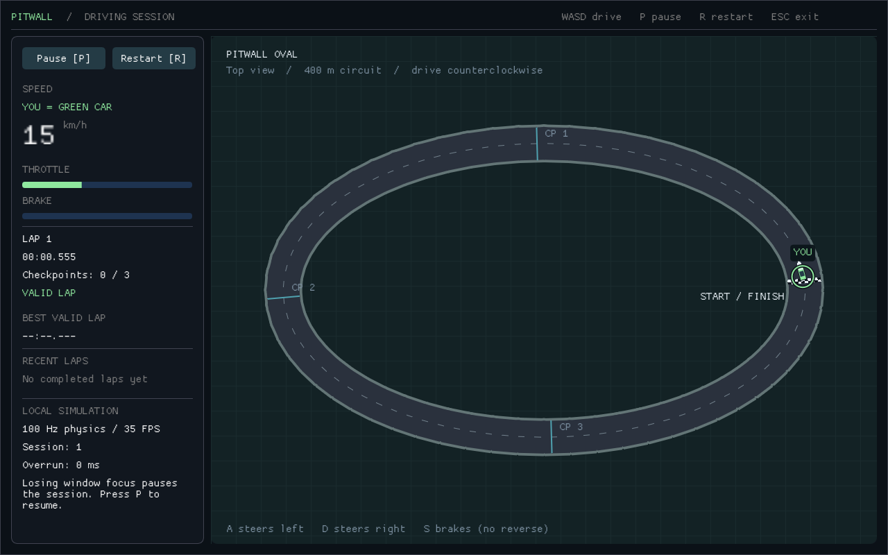

# PitWall

Racing Simulator & Telemetry Analyzer, written in C++20.

**Status: Interactive Windows Simulator (0.4.1).** A top-down window now renders the
road, car, start/checkpoints and a driving dashboard. WASD controls the existing
100 Hz vehicle model, P pauses and R restarts. Lap timing receives every physics
tick. UDP, the Analyzer dashboard, SQLite, replay and lap comparison remain planned.



0.4.1 fixes clipped native-window rendering on scaled Windows displays. A startup
PerMonitorV2 manifest aligns the window, WGL and UI pixel spaces; DPI-change messages
resize the window. The car now has a prominent YOU ring and an off-map indicator.
The native window framebuffer (not only an offscreen buffer) was verified on MinGW
and MSVC. Close the old simulator before rebuilding its executable.

## Interactive simulator on Windows

```powershell
$env:Path = 'C:\msys64\ucrt64\bin;' + $env:Path
cmake --preset windows-mingw-gui
cmake --build --preset windows-mingw-gui --parallel 2
ctest --preset windows-mingw-gui
.\build\windows-mingw-gui\apps\simulator\pitwall_simulator.exe --drive
```

W accelerates, S brakes (no reverse), A/D steer, P pauses/resumes, R restarts and
Escape closes. Buttons also pause/restart. Losing focus or minimizing pauses the
session; press P or Resume after returning. Ordinary no-argument startup still
prints status and exits, so automated startup tests never open a window.

For MSVC use the `windows-msvc-gui` configure/build/test presets and launch
`build/windows-msvc-gui/apps/simulator/Debug/pitwall_simulator.exe --drive`.

The current GUI adapter uses Win32/WGL + OpenGL 3.0+ and vendored Dear ImGui sources,
with no package download. A working GPU driver is required. This adapter is Windows
only; headless libraries remain independent of it. A GLFW adapter is deferred until
a supported source dependency is available. See [GUI architecture](docs/gui.md) and
[third-party provenance](third_party/imgui/PROVENANCE.md).

In VS Code, install the recommended C/C++ extension, select `PitWall: Drive (MinGW)`
and press F5. Tasks configure/build before launching. The debugger path is
`C:/msys64/ucrt64/bin/gdb.exe`; adjust if needed. An interactive VS Code debugger
session has not been tested.

## Headless build on Windows: available MinGW toolchain

Requirements: CMake 3.24+, a C++20 compiler, and `mingw32-make` on PATH.
For MSYS2 UCRT64, add its `ucrt64/bin` directory to PATH. All build commands below
run from the directory containing this README.

```powershell
cmake --preset windows-mingw
cmake --build --preset windows-mingw --parallel 2
ctest --preset windows-mingw
.\build\windows-mingw\apps\simulator\pitwall_simulator.exe
.\build\windows-mingw\apps\simulator\pitwall_simulator.exe --demo
.\build\windows-mingw\apps\simulator\pitwall_simulator.exe --track-demo
.\build\windows-mingw\apps\analyzer\pitwall_analyzer.exe
```

Both programs also accept `--help` and `--version`. Unknown arguments return exit
code 2. Normal startup prints status and exits. Simulator `--demo` computes 12
seconds of acceleration, left turning and braking, printing one row per simulated
second. It runs without sleeping and opens no window. It is a scripted input sequence,
not an autopilot. Analyzer is still the foundation entry point.

Simulator `--track-demo` feeds scripted centreline positions to the lap tracker and
prints two valid laps on the default 400.274 m oval (approximately 20.014 s per lap
at 20 m/s). This checks geometry/timing, not autonomous driving. An integration test
separately drives the actual vehicle model with constant controls around a circular
test track and verifies two timed laps. Neither demo opens a graphical window.

## Visual Studio 2022

Install the Desktop development with C++ workload, then:

```powershell
cmake --preset windows-msvc
cmake --build --preset windows-msvc
ctest --preset windows-msvc
.\build\windows-msvc\apps\simulator\Debug\pitwall_simulator.exe
.\build\windows-msvc\apps\analyzer\Debug\pitwall_analyzer.exe
```

## GoogleTest via vcpkg

The default headless build has no external dependencies. Its small offline test
runner executes the same domain contract as the optional GoogleTest runner.
To enable GoogleTest, install/bootstrap vcpkg separately and set `VCPKG_ROOT`:

```powershell
$env:VCPKG_ROOT = 'C:\dev\vcpkg'
cmake --preset windows-msvc-vcpkg
cmake --build --preset windows-msvc-vcpkg
ctest --preset windows-msvc-vcpkg
```

The manifest currently requests only `gtest`. Add graphics, network and storage
packages when their implementations are introduced. A registry baseline is not yet
pinned: dependency reproducibility is a pending foundation task. Once vcpkg is
available, run `vcpkg x-update-baseline --add-initial-baseline` from this directory
and commit the resulting `builtin-baseline`. External dependencies require network
access or a prepopulated package cache.

## Linux

```sh
cmake --preset linux-debug
cmake --build --preset linux-debug --parallel 2
ctest --preset linux-debug
./build/linux-debug/apps/simulator/pitwall_simulator
./build/linux-debug/apps/analyzer/pitwall_analyzer
```

Linux and GoogleTest configurations have not been locally verified yet.

## Architecture

See [architecture](docs/architecture.md), [telemetry contract](docs/telemetry.md),
[roadmap](docs/roadmap.md) and [verification](docs/verification.md).
See [track rules](docs/tracks.md) for the geometry and timing contracts.

Current source layout:

- `apps/simulator`: simulator entry point.
- `apps/simulator/driving_session.*`: platform-independent app composition.
- `apps/simulator/gui_*`: Windows host and ImGui scene/dashboard rendering.
- `apps/analyzer`: analyzer entry point.
- `libs/domain`: shared telemetry types and stateless field validation.
- `libs/simulation`: vehicle parameters, physics and a bounded fixed-step accumulator.
- `libs/track`: closed road geometry, projection, swept motion checks and lap tracking.
- `tests`: domain, physics, frame scheduling, track/lap and application checks.
- `docs`: design decisions, planned milestones and verification evidence.
- `third_party/imgui`: source snapshot with MIT license and hashes.

No empty module libraries or placeholder interfaces are created for future features.
Windows is the primary target; domain code uses only standard C++20.

## Development

Use `.clang-format` for source formatting. Avoid serializing C++ object memory;
the future wire codec must define an independent format. Keep UI and third-party
dependencies out of the domain library. Build and test after each small milestone.

Suggested milestone commit: `feat: add interactive simulator with keyboard controls`.

License: MIT; see [LICENSE](LICENSE).
